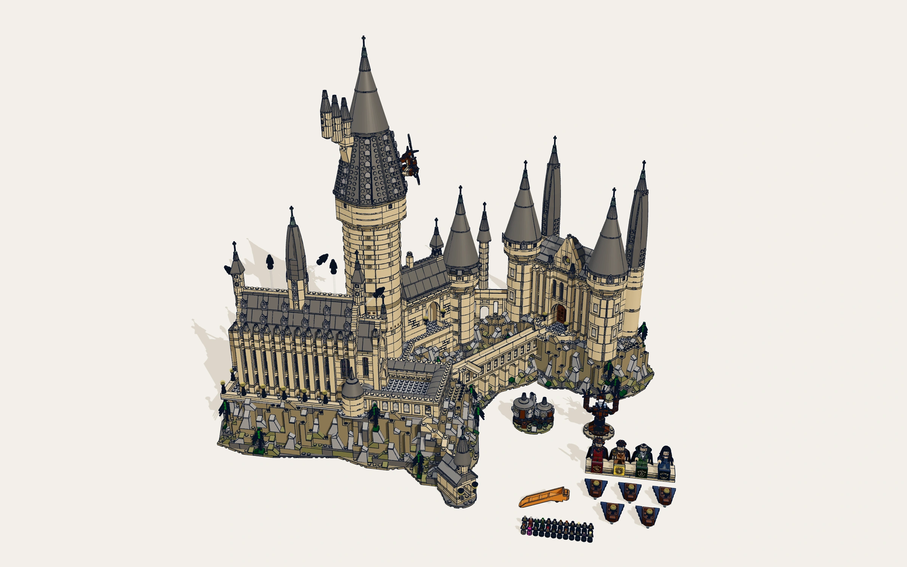
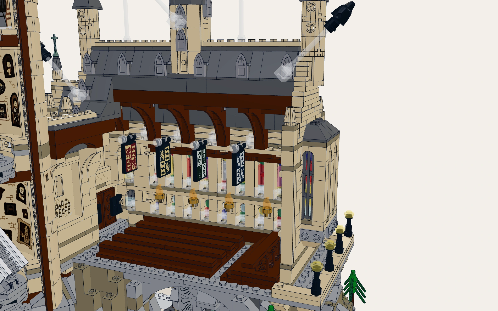
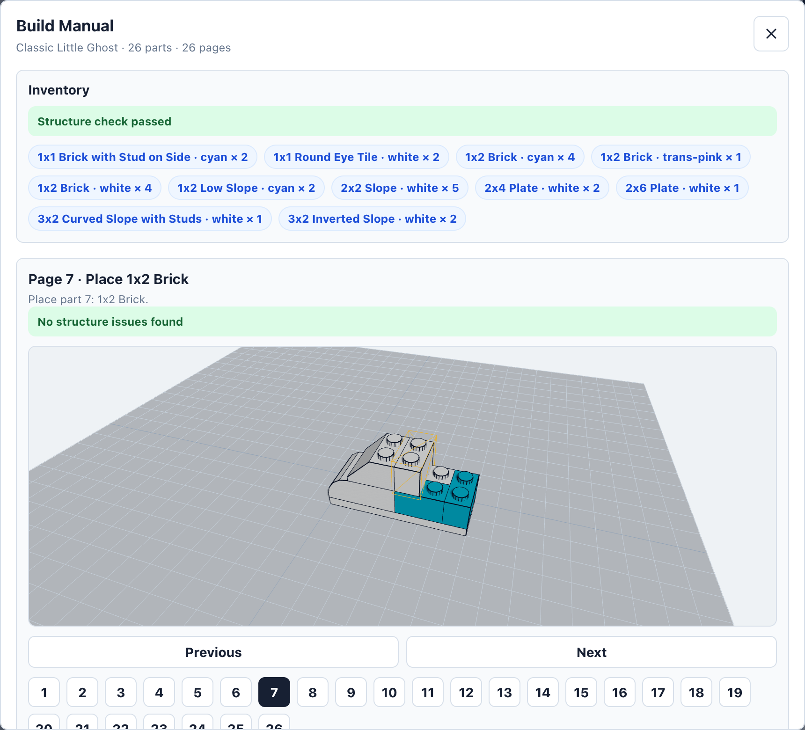
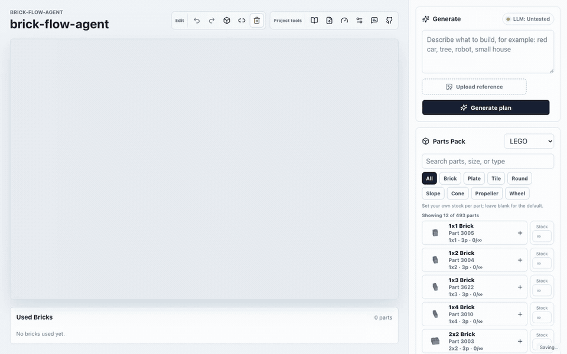

# Brick Flow Agent

A 3D brick-building workspace in your browser. Open a model and make it your own, build from scratch, or start with a prompt or reference image.

**[Open the live demo](https://ninjarz.github.io/brick-flow-agent/)** · [Chinese README](docs/README_zh.md)

[](https://ninjarz.github.io/brick-flow-agent/)

*LEGO 71043 Hogwarts Castle · 6,025 editable pieces. Find it in the Asset Library.*

## Try it in the browser

1. **Explore a model.** Open Hogwarts Castle or another model from the Asset Library, then rotate the view and edit individual pieces.
2. **Follow the build.** Open the Build Manual to step through assembly, or use the Stability Lab to see how a structure responds to wind, heavy rain, and earthquakes.
3. **Make something of your own.** Build with LEGO-compatible parts or Minecraft-style blocks, import a JSON, LDraw/MPD, or OBJ file, or generate a starting point from an idea or image.

<p align="center">
  
  
</p>

The editor and built-in models are ready to use without an account or API key. For optional AI generation, open **Config** and enter your OpenAI-compatible endpoint, model name, and API key. In browser-direct mode, the app sends your prompts and any attached reference image to the endpoint you configure.

## Watch a build take shape



This shortened recording uses simulated model responses. The app compiles and validates all 397 pieces through its step-by-step building workflow.

## Run locally

Install Git and Node.js 20 or later, which includes npm. Run these commands in a terminal:

```bash
git clone https://github.com/ninjarz/brick-flow-agent.git
cd brick-flow-agent
npm ci
npm run dev
```

`npm ci` installs the dependencies pinned in `package-lock.json`. For this setup, run it once before starting the server.

1. Open the URL printed by Vite, usually [http://localhost:5173/brick-flow-agent/](http://localhost:5173/brick-flow-agent/). Vite may choose another port if 5173 is in use.
2. Open **Asset Library** to load a model, or use **Config** to set up optional AI generation.
3. Keep the terminal open while you use the app. Press `Ctrl+C` to stop the server. To start it again, run `npm run dev` from the `brick-flow-agent` directory.

To preview a production build locally, run `npm run build` followed by `npm run preview`, then open the printed URL. The static site files are in `dist/`. Before opening a pull request, run `npm run verify:release`.

## Learn more

[LEGO replica sources and verification](docs/lego-replicas.md) · [Stability model](docs/STABILITY_MODEL.md) · [Report an issue](https://github.com/ninjarz/brick-flow-agent/issues)

Part geometry and color references come from [LDraw](https://ldraw.org/) and [Rebrickable](https://rebrickable.com/downloads/).
