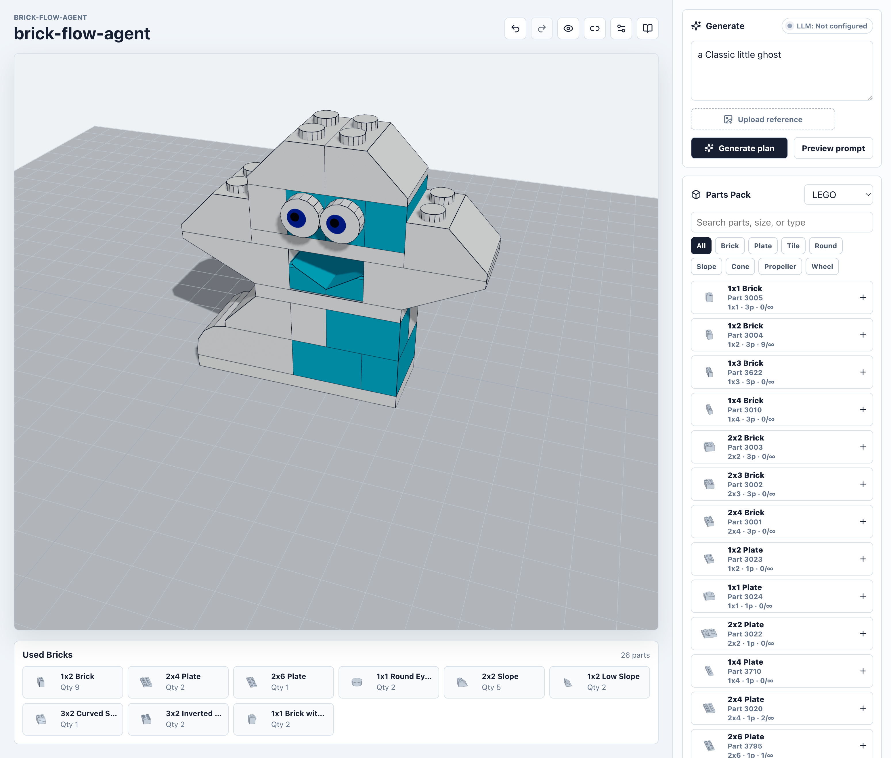
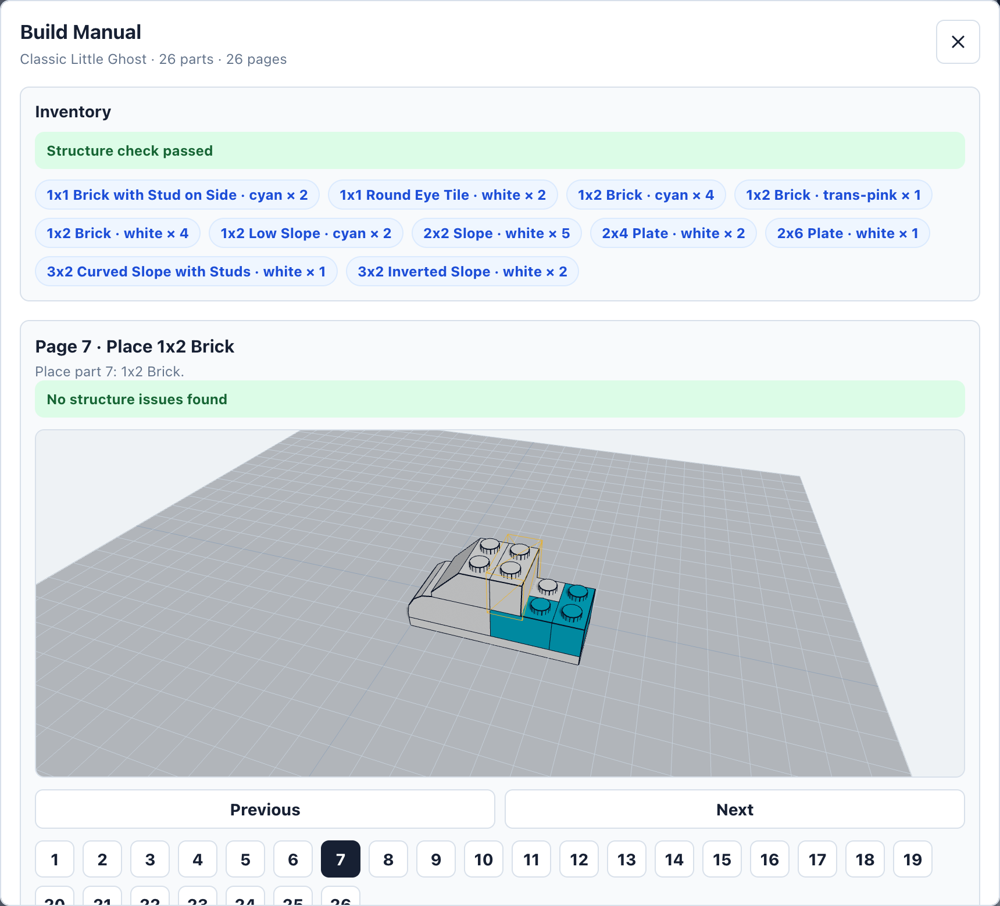
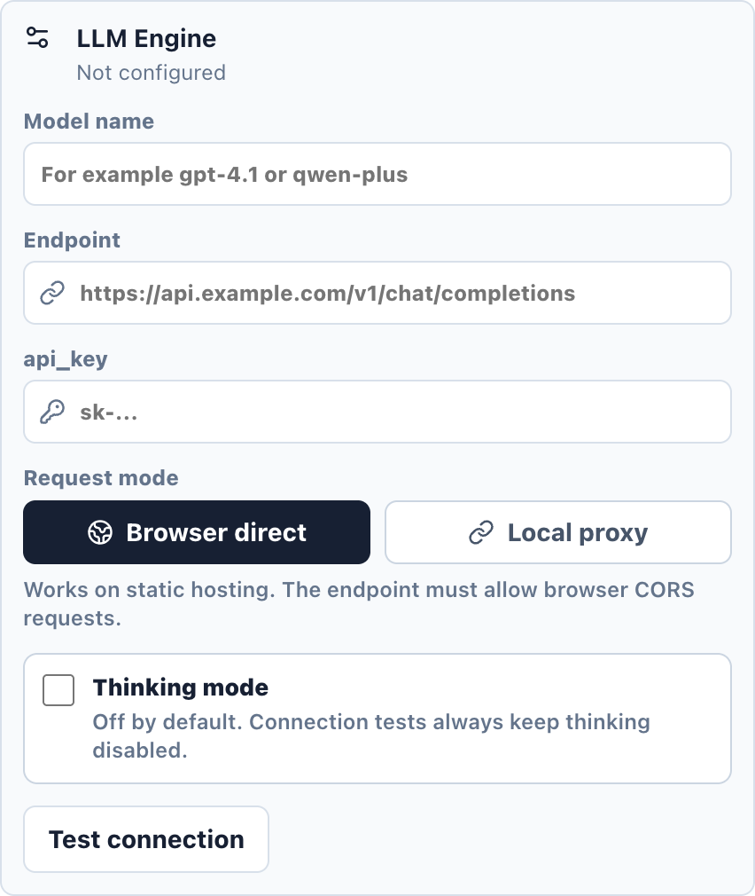

# brick-flow-agent

> A browser-based workspace for brick-like construction systems, powered by part packs, LDraw geometry, structural voxels, and optional LLM generation

[](https://react.dev/)
[](https://threejs.org/)
[](https://vite.dev/)
[](https://www.typescriptlang.org/)

English README | [中文文档](docs/README_zh.md)

brick-flow-agent, also named 积流工坊 in Chinese, turns prompts, imported plans, and hand-edited layouts into an interactive 3D building workspace. The goal is to bring different brick-like systems into one editor: LEGO-compatible LDraw parts today, Minecraft-style voxel blocks next, and more part packs later

The app uses React + Three.js for the editor, LDraw data for part rendering, and connector plus structural voxel rules for collision, support, and validation. It also includes a local asset library, voxel debugging, build-manual preview, and Markdown/HTML/JSON export

## ✨ Highlights

- Prompt-to-build generation through OpenAI-compatible LLM endpoints
- Static-hosting friendly browser-direct LLM requests, with an optional local proxy for CORS-restricted APIs
- Part-pack switching, currently with a LEGO-compatible LDraw pack and an early Minecraft pack
- LDraw-derived visual and structural data for part rendering, collision, and support checks
- Brick-level editing: add, select, move, rotate, recolor, duplicate, delete, import, and export
- Connector validation for studs, tubes, bars, pins, axles, and bidirectional block faces
- Structural voxel debug view for solids, sockets, studs, bidirectional faces, and enterable cells
- Built-in asset library with local persistence for user models
- Build manuals generated as one part per step, with Markdown, HTML, and JSON export
- Bilingual UI with browser-language defaults and manual language selection

<p align="center">
  
  
</p>

## 🧱 Part Packs

- **LEGO-compatible pack:** the main pack today. It uses bundled LDraw data where possible for visuals and structure, with regression checks for official colors, connector positions, collision, support, and default assets
- **Minecraft pack:** an early voxel-first pack. It currently includes a basic `1 x 1 x 1` block

## 🚀 Quick Start

```bash
npm install
npm run dev
```

Open the Vite URL printed in the terminal, usually:

```text
http://127.0.0.1:5173/
```

## 🛠️ Build

```bash
npm run build
npm run preview
```

The app can run as a static frontend when LLM requests use browser-direct mode and the configured endpoint allows CORS

## 🧪 Development Scripts

```bash
npm run dev                  # start Vite
npm run build                # type-check and build
npm run lint                 # run ESLint
npm run validate:builds      # validate default assets and regression cases
npm run profile:performance  # profile performance-sensitive routines
```

## 🤖 LLM Configuration

Open **Config** in the app and set:

<p align="center">
  
</p>

- API endpoint: an OpenAI-compatible chat completions URL
- API key: stored locally in the browser
- Model name: any model supported by your endpoint
- Request mode: browser direct or local proxy
- Thinking mode: optional, off by default for faster and more predictable generation

## ⌨️ Keyboard Controls

Keyboard controls are ignored while typing in text fields. Brick movement works after a brick is selected, moves in `1/5` stud steps, and repeats while the key is held.

| Key | Action |
| --- | --- |
| `W` / `A` / `S` / `D` | Move the selected brick relative to the current camera view |
| `R` / `F` | Move the selected brick up or down |
| `Q` | Rotate the selected brick horizontally |
| `E` | Rotate the selected brick vertically |
| `Backspace` | Delete the selected brick |
| `Ctrl`/`Cmd` + `Z` | Undo |
| `Ctrl`/`Cmd` + `Shift` + `Z` or `Ctrl`/`Cmd` + `Y` | Redo |
| `Esc` | Close the open config, prompt preview, asset library, or build manual dialog |
| `←` / `→` | Move to the previous or next build-manual step while the build manual is open |
| `Enter` / `Space` | Select a focused build-manual step card |

## 🧩 Working With Parts

New or corrected parts should be backed by real references:

1. Check the official LDraw `.dat`, subpart, and primitive data
2. Compare against official LEGO imagery or build-manual images when visual shape matters
3. Preserve real part numbers, dimensions, connector semantics, and regression coverage
4. Run `npm run generate:ldraw` and `npm run validate:builds` after changing LDraw-derived data

For non-LEGO packs, prefer explicit structural semantics instead of forcing every system into LEGO stud and tube rules. The Minecraft basic block uses a bidirectional `studsocket` face connector so the block stays solid while still supporting face-to-face attachment

## 🤝 Contributing

Issues and patches are welcome. Useful contribution areas include:

- Improving the agent workflow
- Expanding the part library and correcting part data
- Adding asset-library inventory management
- Creating polished demo assets
- Improving import and export format compatibility
- Optimizing performance

Before opening a pull request:

```bash
npm run lint
npm run build
npm run validate:builds
```

If `validate:builds` fails because of an existing demo regression, call that out clearly in the PR notes

## 🙏 Acknowledgements

- [LDraw](https://ldraw.org/): open part geometry, primitives, and the community-maintained part library that make the LDraw-backed pack possible
- [Rebrickable](https://rebrickable.com/downloads/): public element and color datasets used to derive coarse official color availability
