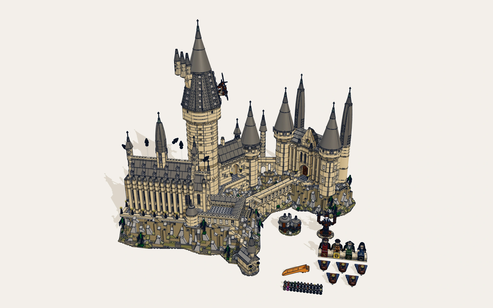
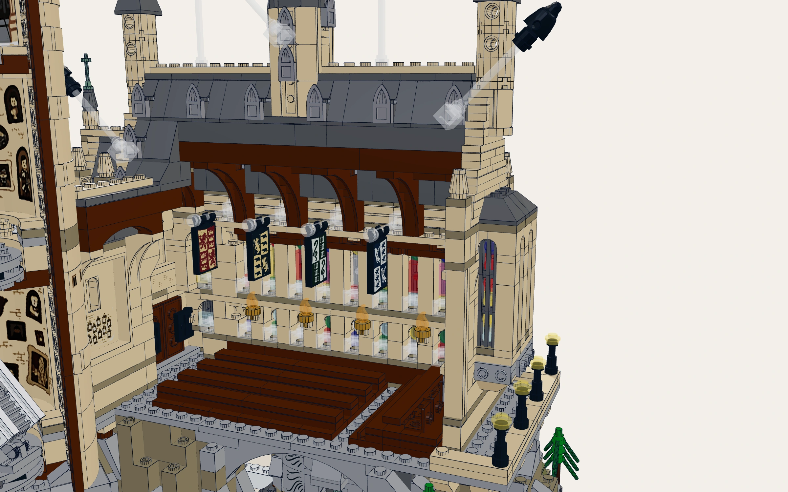
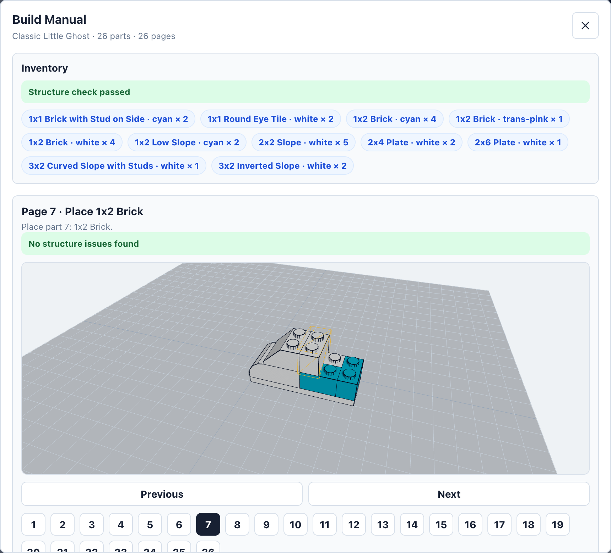
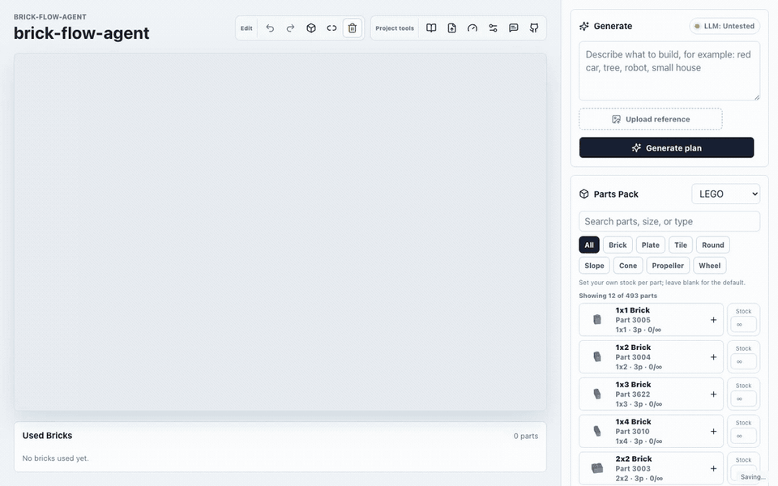

# 积流工坊

在浏览器里拼搭积木。你可以打开现成模型逐件编辑，从空画布开始搭建，也可以用文字或参考图生成一个起点。

**[打开在线试玩](https://ninjarz.github.io/brick-flow-agent/)** · [English README](../README.md)

[](https://ninjarz.github.io/brick-flow-agent/)

*LEGO 71043 霍格沃茨城堡共有 6,025 个可编辑零件，可在素材库打开。*

## 在浏览器里试试

1. **逛一逛现成模型。** 从素材库打开霍格沃茨或其他作品，旋转视角查看细节，也能移动或修改单个零件。
2. **看模型怎么搭起来。** 打开搭建手册逐步查看装配过程，或在稳定性实验室里观察风、暴雨和地震对结构的影响。
3. **搭自己的作品。** 使用 LEGO 兼容零件或 Minecraft 风格方块，导入 JSON、LDraw/MPD 或 OBJ 文件，也可以输入一句话或上传参考图开始生成。

<p align="center">
  
  
</p>

编辑器和内置模型可直接使用。需要 AI 生成时，在「配置」里填写兼容 OpenAI 的接口地址、模型名和 API Key。使用浏览器直连时，提示词和上传的参考图会发送到你配置的接口。

## 看一栋木屋怎么搭起来



这段录屏压缩了等待时间，使用模拟的模型响应。397 个零件由应用的逐步搭建流程生成并校验。

## 本地运行

先安装 Git 和 Node.js 20 或更高版本。Node.js 自带 npm。在终端执行以下命令：

```bash
git clone https://github.com/ninjarz/brick-flow-agent.git
cd brick-flow-agent
npm ci
npm run dev
```

`npm ci` 会按 `package-lock.json` 安装项目依赖。首次启动前执行一次即可。

1. 打开终端显示的 Vite 地址，通常是 [http://localhost:5173/brick-flow-agent/](http://localhost:5173/brick-flow-agent/)。如果 5173 端口已被占用，以终端打印的端口为准。
2. 打开「素材库」加载一个模型，或在「配置」里启用可选的 AI 生成。
3. 使用时保持终端开启。按 `Ctrl+C` 停止服务。下次启动时进入 `brick-flow-agent` 目录，再运行 `npm run dev`。

要在本地预览生产版本，先运行 `npm run build`，再运行 `npm run preview` 并打开终端显示的地址。静态构建产物位于 `dist/`。提交 PR 前可运行 `npm run verify:release`。

## 进一步了解

[乐高复刻来源与校验](lego-replicas.md) · [稳定性模型](STABILITY_MODEL.md) · [反馈问题](https://github.com/ninjarz/brick-flow-agent/issues)

零件几何和颜色资料来自 [LDraw](https://ldraw.org/) 和 [Rebrickable](https://rebrickable.com/downloads/)。
